# Volumetric Fog in Vulkan

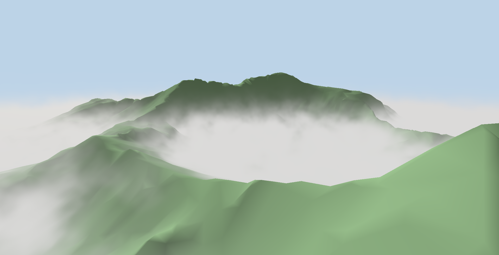

*The finished fog, filling a valley while the hilltops stay clear.*

## 1. Introduction

Whether it be how I dress, decorate my home, or make a character in a game, I have always had an interest in making things look aesthetically pleasing. With this background, I found that the most profound way to affect this in computer games is to take control of and manipulate the pixels.

Fog is one of the oldest tricks in real-time graphics. It hides the end of the world, gives a sense of depth, but can also set a mood. Most engines can implement some sort of simple fog: the further away something is, the more that object gets covered by fog. This is functional but also cheap. However, the constraint is that the fog only knows *how far away* something is, not *where the fog actually is*. It cannot make a valley full of mist while the hilltops stay clear.

Volumetric fog treats fog as something that exists in the space of the scene. Each point in space has its own density, and the color of a pixel depends on how much fog the camera looks *through* to reach it.

The word *volumetric* comes from *volume*, something that fills a space in 3D. With simple fog, only the surface of each object is looked at, and the only thing that matters is its distance from the camera. The air between the camera and the object is never part of the calculation. With volumetric fog, the fog lives *in the air*. Every point in the room has its own thickness, and everything between the camera and the object counts. This is what makes it possible for the fog to lie thick on the ground, be thin higher up, and be uneven, with thicker and thinner areas.

A good example of how much fog can mean for a game is the *Silent Hill* series. In the first game, the fog was partly a way to hide how short the original PlayStation could draw, but it became the identity of the whole series, and *Silent Hill 2* from 2001 kept it. In the remake from 2024, the fog is volumetric: it lies in the streets, moves, and catches the light.

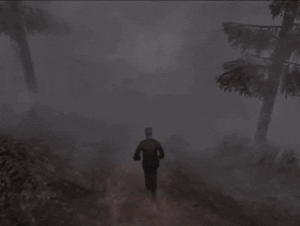

*Silent Hill 2 (2001). The fog hides the end of the world and sets the mood.*

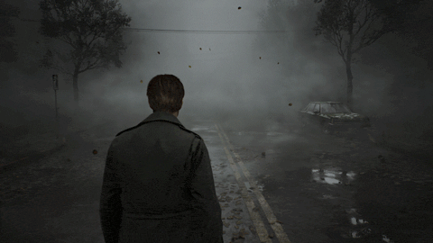

*Silent Hill 2 remake (2024). The fog fills the space between the player and the street.*

In this project, I built volumetric fog in Vulkan, on top of the small engine from Brendan Galea's Vulkan tutorial series.

This project would be of interest to someone wanting the exact same result using Vulkan, but would also be helpful to someone wanting to use ray marching for some other shader end goal, since it's widely and commonly used.

## 2. Research question

**How do you make volumetric fog in Vulkan?**

The question is not only how fog is calculated, but how it is made to work inside a real Vulkan engine, with a moving camera, 3D objects and time. In Vulkan, nothing is given for free, so the question also covers how the information gets from the C++ code on the CPU to the shader on the GPU, and how the fog is laid over the scene.

Volumetric fog is used in many modern games to create mood and depth, and to control what the player can see. During my research, I found many examples of fog in a single shader online, and fog solutions built into specific game engines, but few that show the whole way into a Vulkan engine.

My plan was to work in three steps. First, I learned the basics of Vulkan through Brendan Galea's tutorial series. Then I built a prototype of the fog in ShaderToy, a website for testing shaders, before moving it into my Vulkan engine. Last, I connected the fog to the camera, the objects and the time.

I split the goal into three levels:

- **Must:** fog that is thick near the ground and thin higher up (height fog).
- **Goal:** animated, patchy fog where close objects get less fog than far ones.
- **Stretch:** light in the fog (light shafts).

Splitting the goal like this meant that I always had something working to show, even if I did not reach the last level.

## 3. Research

### Volumetric fog in the industry

Volumetric fog has been a standard feature in big game engines for more than ten years. Two talks from the SIGGRAPH conference show how it is usually done. Bart Wronski described the volumetric fog in *Assassin's Creed IV: Black Flag* (2014), and Sébastien Hillaire (2015) described the fog in EA's Frostbite engine, used in games like *Battlefield*. Unreal Engine, which the *Silent Hill 2* remake is built in, has volumetric fog as a built-in feature.

These solutions have a lot in common with mine. They all use the Beer–Lambert law to decide how much light gets through the fog, and they all let the fog add a little light of its own along the way. The difference is how the work is split up. The big engines divide the space in front of the camera into a 3D grid of small boxes, calculate the fog once for each box with compute shaders, and reuse the result from earlier frames. This is fast, but it needs a lot of setup.

I took the same ideas but chose a simpler structure: ray marching once for every pixel, in the fragment shader. It costs more for every pixel, but it was possible to finish in the time I had. The big engines also save time in another way: since fog is soft and has no sharp edges, it does not need to be calculated in every pixel.

### What is Vulkan?

Vulkan is a new generation API used for both graphics and computing, made by The Khronos Group. It enables high efficiency by being low-level, and some may even describe it as verbose, because it is very explicit. But with its complexity comes a lot of control and power.

Vulkan is a cross-platform API. It works on Windows, Linux and Android, and on some consoles such as the Nintendo Switch. On macOS and iOS it runs through a translation layer called MoltenVK. Few graphics APIs cover this many platforms.

In comparison to its predecessor OpenGL, Vulkan is a much more low-level API, a GPU API rather than only a graphics API. Vulkan was released in 2016, while OpenGL was released in 1992. OpenGL was first made by Silicon Graphics, but is now maintained by The Khronos Group as well.

Vulkan was derived from the Mantle API made by AMD and DICE, and it is created, maintained and evolved by The Khronos Group.

Almost everything in Vulkan is created in the same way. First you fill in a "create info" struct that describes what you want. Then you hand that struct to a `vkCreate...` function, and check that it worked. The `sType` field tells Vulkan which kind of struct it is getting. This is how the pipeline layout for my fog is created:

```cpp
VkPipelineLayoutCreateInfo pipelineLayoutInfo{};
pipelineLayoutInfo.sType = VK_STRUCTURE_TYPE_PIPELINE_LAYOUT_CREATE_INFO;
pipelineLayoutInfo.setLayoutCount = static_cast<uint32_t>(descriptorSetLayouts.size());
pipelineLayoutInfo.pSetLayouts = descriptorSetLayouts.data();
pipelineLayoutInfo.pushConstantRangeCount = 0;
pipelineLayoutInfo.pPushConstantRanges = nullptr;

if (vkCreatePipelineLayout(lveDevice.device(), &pipelineLayoutInfo, nullptr, &pipelineLayout) != VK_SUCCESS) {
    throw std::runtime_error("failed to create pipeline layout!");
}
```

Buffers, images, shaders and the pipeline itself are all made with the same pattern. This is a big part of why Vulkan code gets so long: every object needs its own struct, and every field has to be filled in.

### Choosing a method

There are a few ways to make fog. Particles are easy, but the fog is made of sprites, which can be seen when the camera moves through them. Simulating the fog with compute shaders is very realistic, but also very advanced. I chose **ray marching**: for every pixel, walk along its view ray in small steps and add up the fog it passes through. It is truly volumetric, and it can be tested in a single shader before building anything in Vulkan.

### The graphics pipeline

The graphics pipeline is a linear sequence of stages. Each stage takes some data as input, performs some operation on it, and outputs the transformed data, which becomes the input for the next stage in the sequence. It is almost like an assembly line: every stage is a different worker that needs a different input from the worker before it, before the final result is shown on screen.

The first stage is the **Input Assembler**. It takes the numbers provided by the vertex and index buffers and puts them together into geometry. In the case of my first triangle, this was six numbers: an x and a y position for each of the three corners.

The second stage is the **Vertex Shader**. It takes the vertices of the triangle one at a time and transforms them, for example, with rotations and translations, and finally places them on the screen.

In **Rasterization**, the triangle gets cut up into fragments, one for each pixel the triangle overlaps. The computer does not know how to draw a triangle; it can only color individual pixels. Rasterization figures out which pixels lie inside the triangle. A fragment is a package of information about the pixel it belongs to, such as its depth. Values stored in each corner of the triangle, like a color, are blended across the fragments by interpolating between the corners.

The **Fragment Shader** takes these fragments and processes them one at a time. It outputs the color of the fragment, which it can calculate from things like textures, normals, and lighting. In my project, this is also where the fog is calculated.

After the fragment shader comes the **Depth Test**. It keeps track of how close the nearest object is in each pixel, so that near objects hide far ones.

The final stage is **Color Blending**, where the color of the new fragment is mixed with the color that is already in the image at the same pixel.

Three of these stages matter most for the fog. The **fragment shader** is the most important, because that is where all of the fog math runs, once for every pixel. **Depth** matters because the fog depends on how far away each object is. And **blending** is how the fog is laid on top of the scene as a see-through layer.

### How much light gets through fog

Light that travels a distance through fog gets weaker, because the fog blocks part of it. This is the Beer–Lambert law:

```
transmittance = exp(−density × distance)
```

The transmittance tells how much of the light gets through. A transmittance of 1 means fully see-through, and 0 means fully hidden by fog. If the fog is thicker, or the light has to travel further, less light gets through.

### Ray marching

Normal ray marching and ray marching through fog both walk along a ray from the camera through a pixel, but they look for different things.

Normal ray marching is used to find *where the ray hits a surface*. At every step it asks: "How far is it to the nearest object from here?" It then takes a step exactly that long. This is always safe: if the nearest object is two meters away, the ray can move two meters without going through anything. The steps are of different lengths: long in empty air and short close to objects. We therefore give it three conditions for when it should stop.

1. When the distance is almost zero, because then it has hit the surface.
2. When it has taken a set number of steps. Otherwise, a ray running close to or parallel with a surface would take a lot of small steps until it either hits or misses, and in the worst case it could take an infinite number of steps.
3. When it has traveled a set distance. If it has traveled this set distance, we tell it to draw the background color.

I used this kind of ray marching in my prototype to draw a sphere and a floor.

Ray marching through fog is used to find out *how much fog the ray passes through*. Fog has no surface to hit, so the question at every step is instead: "How thick is the fog here?" The steps are all the same length, and the march does not stop at a hit. It walks the whole way, up to the object or up to a maximum distance. At every step, the transmittance is reduced a little, using the Beer–Lambert law:

```glsl
for (int i = 0; i < FOG_STEPS; i++) {
    vec3 slicePosition = rayOrigin + distanceSoFar * rayDirection;
    float localDensity = FogDensity(slicePosition);
    transmittance *= exp(-(localDensity * stepSize));
    distanceSoFar += stepSize;
}
```

In short, normal ray marching answers *where* the surface is, while fog ray marching answers *how much* fog there is along the way. More steps give smoother fog, but cost more, because every step is work for every pixel.

### What builds the fog

To build the actual fog, I made a function called FogDensity. This function takes a point in space and gives back a number: how thick the fog is right there. A larger number means thicker fog, and a smaller number means thinner fog. The number is largest close to the ground and gets smaller higher up. Before the number is returned, it is multiplied by noise. The noise makes the fog uneven, so it is thicker in some places and thinner in others.

```glsl
float FogDensity(vec3 position) {
    // height: thick at the fog floor, thinner going up (+y is down in this engine)
    float fogFloor = FOG_FLOOR_Y + sin(ubo.time * FOG_BREATHE_SPEED) * FOG_BREATHE_HEIGHT;
    float heightAboveFloor = max(fogFloor - position.y, 0.0);
    float heightFog = FOG_DENSITY * exp(-(heightAboveFloor * FOG_FALLOFF));

    // noise: read it at a position that moves with the wind
    vec3 noisePosition = position * NOISE_SCALE - WIND_VELOCITY * ubo.time;
    float patches = smoothstep(.3, .75, LayeredNoise(noisePosition));

    return heightFog * mix(1.0, patches * 2.0, NOISE_STRENGTH);
}
```

The first part is the height. The fog floor moves slowly up and down with a sine wave, so the whole layer breathes. Above the floor, the density falls off with `exp`, so it fades smoothly instead of stopping at a hard line. The second part is the noise, which is explained under *Noise and light*. The two parts are multiplied, so the noise can make the fog patchy, but it can never lift fog up into the sky where the height part is already zero.

## 4. Knowledge sharing

### Learning Vulkan

Before I could start on the fog, I had to have a render engine up and running in Vulkan. The Khronos Group has a lot of documentation on how to set up all the basics, but I prefer to have some sort of follow-along, where I can listen and see how someone else builds something. So I continued my search and found a tutorial series on YouTube by Brendan Galea. This tutorial series was a great help, and with it I built the full foundation of my render engine.

The tutorial builds the engine one small step at a time. It starts with a single triangle, then moves on to sending small amounts of data to the shaders, drawing many triangles, and then the first 3D object, a spinning cube. After that came a camera that can be moved with the keyboard, loading 3D models, and finally simple lighting.

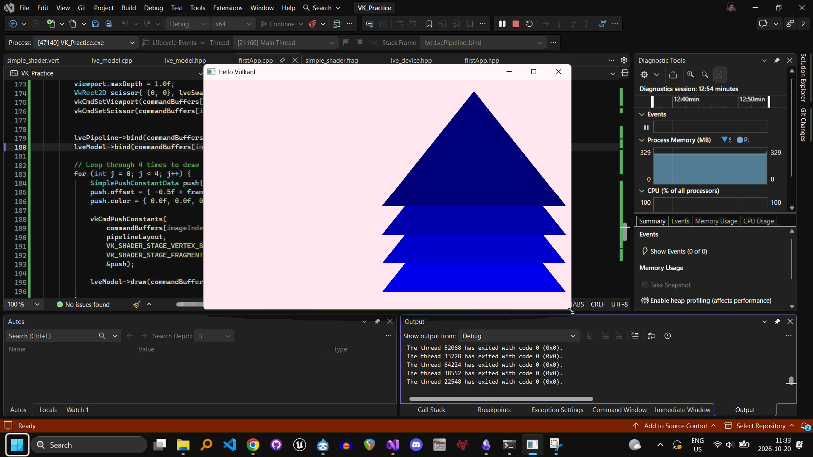

*Sending small amounts of data to the shader every frame.*

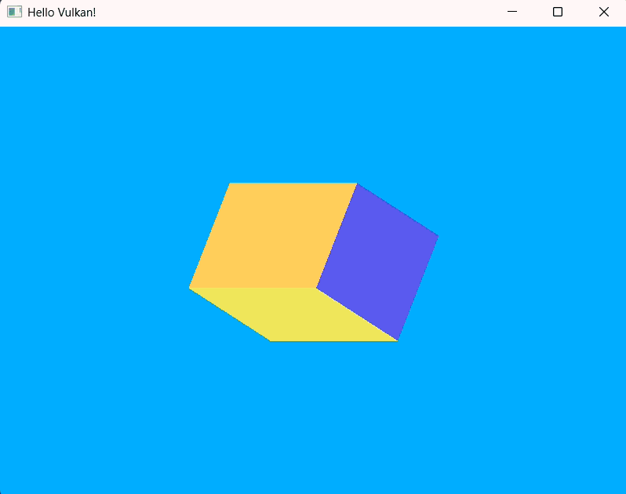

*The first 3D object in the tutorial.*

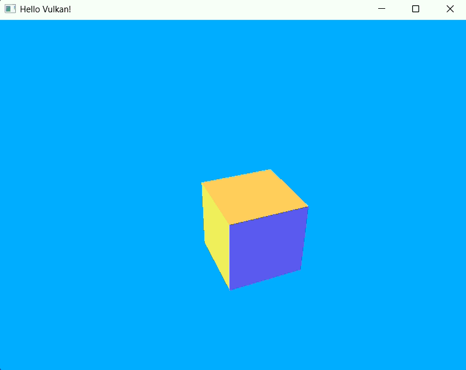

*A camera that can be moved with the keyboard.*

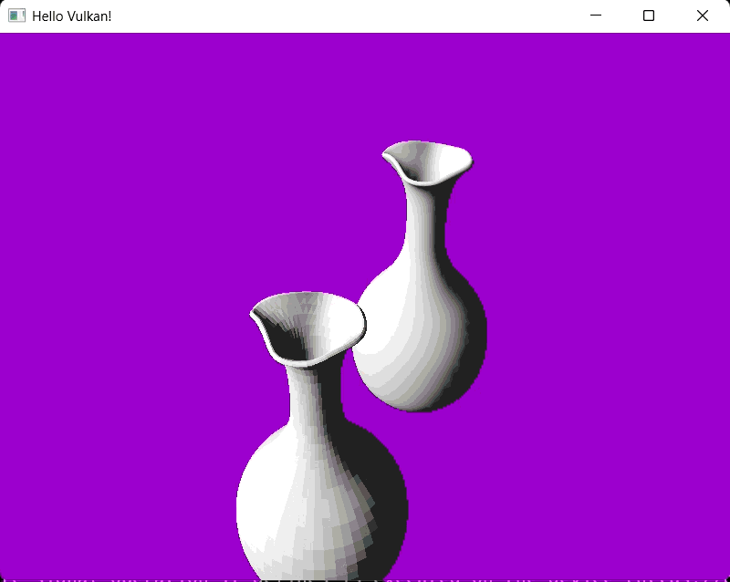

*3D models with lighting.*

### The prototype

I started the prototype in ShaderToy. ShaderToy is a website where you write a single fragment shader and see the result right away. In ShaderToy, some functionality comes built in (like time and a camera), so the main focus can be on the actual math. I started with a ray marched sphere and floor, then added fog: first fog that was equally thick everywhere, then height fog.

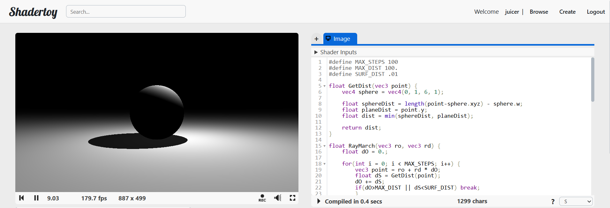

*ShaderToy. The result is on the left and the shader code is on the right.*

Making a prototype first was an important choice. In Vulkan, a black screen can be caused by hundreds of different settings. In the prototype, if something looked wrong, I knew it was the math. Later, when I moved the fog into Vulkan, and something looked wrong, I knew the math already worked, so the problem had to be in the Vulkan setup.

<video src="images/shadertoy_raymarched_sphere.mp4" autoplay loop muted playsinline width="100%"></video>

*The ray marched sphere and floor, before any fog.*

<video src="images/shadertoy_height_fog.mp4" autoplay loop muted playsinline width="100%"></video>

*Height fog in the prototype. After the first tests in ShaderToy, I moved the prototype over to VS Code with a GLSL preview and kept building it there.*

### Moving the fog into Vulkan

The fog math moved over almost unchanged. The hard part was getting the right information to the shader. Everything ShaderToy had given me, like the camera and the time, I now had to send myself.

First, the fog has to run for every pixel on the screen, not only for the pixels covered by the objects. To do this I draw one big triangle that covers the whole screen. Its fragment shader runs once for every pixel and does the ray march. The three corners are written directly in the vertex shader, so no vertex buffer is needed:

```glsl
const vec2 TRIANGLE_CORNERS[3] = vec2[](
    vec2(-1, -1),
    vec2( 3, -1),
    vec2(-1,  3)
);

void main() {
    vec2 corner = TRIANGLE_CORNERS[gl_VertexIndex];
    screenPosition = corner;
    gl_Position = vec4(corner, 1, 1);
}
```

The screen goes from -1 to 1 in both directions, so a triangle with corners at 3 reaches past the edges and covers all of it. In C++, drawing it is a single call: `vkCmdDraw(commandBuffer, 3, 1, 0, 0)`, which means three corners, drawn once.

Second, the shader needs to know where the camera is, which way each pixel looks, and what time it is. I send this from the C++ program to the shader every frame in a uniform buffer, which is a small block of memory that all the shaders can read. It contains the position of the camera, the direction to the sun, the time, and two matrices that turn a position on the screen into a direction in the world. With these, every pixel can work out its own ray. The struct in C++ and the block in the shader must have the same fields in the same order, because the shader reads the memory exactly as C++ wrote it:

```cpp
struct GlobalUbo {
    glm::mat4 projectionView{ 1.f };
    glm::vec3 lightDirection = glm::normalize(glm::vec3(.3f, -.45f, 1.f));
    float time;
    glm::vec4 cameraPosition;
    glm::mat4 inverseProjection;
    glm::mat4 inverseView;
};
```

```glsl
layout(set = 0, binding = 0) uniform GlobalUniformBufferObject {
    mat4 projectionViewMatrix;
    vec3 directionToLight;
    float time;
    vec4 cameraPosition;
    mat4 inverseProjection;
    mat4 inverseView;
} ubo;
```

The names do not have to match, only the types and the order. The `float time` is placed right after the `vec3` on purpose: the GPU reads the buffer in blocks of 16 bytes, and a `vec3` (12 bytes) plus a `float` (4 bytes) fill one block exactly.

In the fragment shader, the two inverse matrices turn the pixel's position on the screen into a direction in the world. The projection matrix and the view matrix normally take a point from the world to the screen, so their inverses go the other way:

```glsl
vec3 GetRayDirection() {
    vec4 rayOri = vec4(screenPosition, 1., 1.);
    vec3 rayDir = (ubo.inverseProjection * rayOri).xyz;
    vec3 worldDir = (ubo.inverseView * vec4(rayDir, 0.f)).xyz;
    return normalize(worldDir);
}
```

At first, every pixel walked the same distance, so a vase close to the camera got as much fog as one far away.

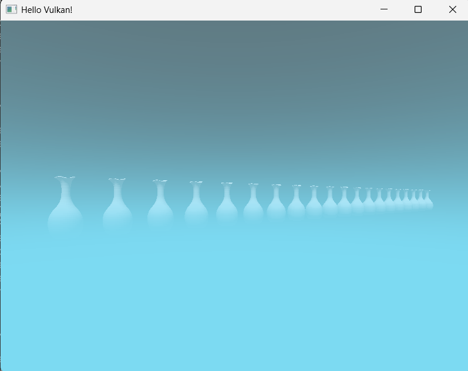

*The first fog in Vulkan. Every pixel walks the same distance, so all vases get the same amount of fog.*

I fixed this by letting each object march only from the camera to itself. Close objects get a short walk and little fog, and far objects get a long walk and more fog. The big triangle over the whole screen is then only used for the background, where there is no object. This is done with two settings on the fog's pipeline:

```cpp
pipelineConfig.colorBlendAttachment.blendEnable = VK_TRUE;
pipelineConfig.colorBlendAttachment.srcColorBlendFactor = VK_BLEND_FACTOR_SRC_ALPHA;
pipelineConfig.colorBlendAttachment.dstColorBlendFactor = VK_BLEND_FACTOR_ONE_MINUS_SRC_ALPHA;

pipelineConfig.depthStencilInfo.depthCompareOp = VK_COMPARE_OP_LESS_OR_EQUAL;
pipelineConfig.depthStencilInfo.depthWriteEnable = VK_FALSE;
```

The triangle is placed at depth 1, the far end of the depth range. Where an object was drawn, the depth buffer holds a smaller number, so the depth test hides the triangle there. Where nothing was drawn, the depth buffer still holds 1, and *less or equal* lets the triangle through. Blending then mixes the fog with what is behind it, using alpha: the more fog, the less of the background shows. To keep this simple, I put all the fog code in one shared file that both shaders include, so the fog looks the same on the objects and in the background.

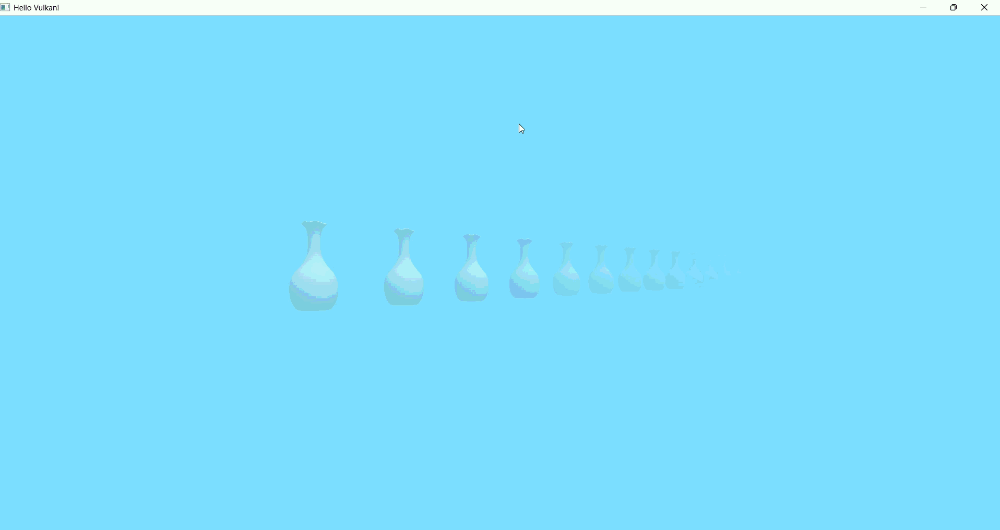

*Close vases are clear, far ones fade into the fog.*

### Noise and light

Height fog alone is a flat layer. To make it more realistic, I used value noise. It functions like an invisible grid of cubes filling the whole scene. Each corner of the grid gets a random number between 0 and 1. The numbers come from a function that randomizes numbers, but the same corner always gets the same number.

For a point between corners, the noise first finds which cube the point is in by rounding its coordinates down. Then it finds how far into the cube the point is, from 0 to 1. The values of the nearby corners are then blended depending on how close the point is to each corner. A point close to one corner gets almost that corner's value, and a point in the middle gets a mix. In 3D a cube has 8 corners, so 8 values are blended together. The blend uses a smooth S-shaped curve instead of a straight line, so there are no hard edges between the cubes. This gives soft patches of thicker and thinner fog. To make the patches more interesting, three layers of noise are added on top of each other. Every new layer has smaller patches and is half as strong, so there are big patches with smaller details inside them.

I chose value noise because it is the simplest noise that gives smooth patches. Other methods are Perlin or Voronoi noise. These would make the patches look better, but are more complex. The noise is based on Inigo Quilez's work and *The Book of Shaders*.

To make the fog feel alive, two things move over time. Moving the grid slowly over time makes the patches drift like wind. And the floor of the fog moves slowly up and down with a sine wave, so the whole layer seems to breathe.

Finally, the fog is made brighter when looking towards the sun. At every step of the march, the fog also adds a little light of its own: some of the fog color, plus some sunlight that gets stronger the closer the ray points towards the sun. This is what makes the soft glow around the sun.

One last problem was stripes. Because every pixel takes the same equal steps, the steps line up and show up as stripes in the fog. I fixed this by letting each pixel start its march at a slightly random distance inside the first step. The stripes then turn into a soft grain that is hard to see. The random number comes from a cheap formula called interleaved gradient noise (Jimenez 2014).

## 5. Presentation

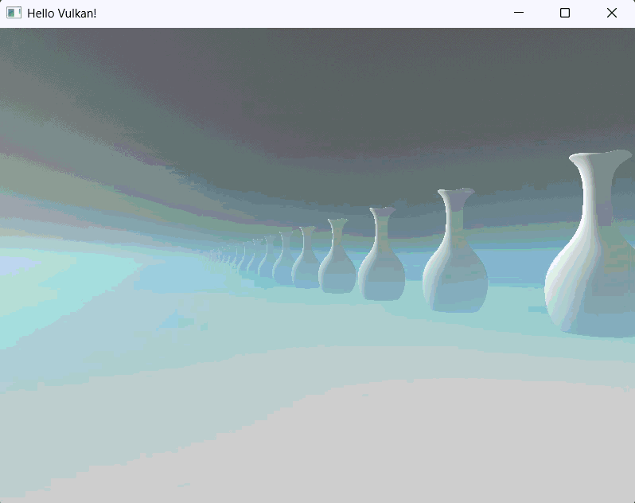

*The final result.*

To show the fog in a bigger scene, I also loaded a terrain with hills and valleys, made by Kris Teper. Because the fog depends on height, it fills the valleys while the hilltops stay clear. The video below compares three settings of the same fog, filmed from the same camera position:

<video src="images/fog_comparison.mp4" autoplay loop muted playsinline width="100%"></video>

*Left: thick fog that stays low in the valleys. Middle: fog that reaches higher and covers the whole terrain more evenly. Right: the same fog with no height and no noise, which is the same as simple distance fog.*

The right side shows why volumetric fog is needed. With simple distance fog, everything far away fades out equally, and the hilltops disappear just as much as the valleys.

Finally, a flight through the finished scene. The camera starts above the fog, dives down into it and flies over the hills. Since the fog exists in the air and not only on the surfaces, the camera can be inside it, and the patches can be seen drifting with the wind:

<video src="images/fog_flythrough.mp4" autoplay loop muted playsinline width="100%"></video>

*Flying through the fog over the terrain.*

The final fog:

- is thick at the floor and thin higher up
- is patchy, and drifts with the wind
- slowly rises and sinks
- makes close objects clear and far objects fade out
- is brighter towards the sun

This means that the must level and the goal level of the research question were both reached. The stretch level, light shafts, was not.

## 6. Reflection

**What went well:** setting up the Vulkan engine. The whole setup was basically just boilerplate. Some parts were quite hard to get a grip on. Making the prototype first worked well, because it separated "is my math wrong?" from "is my Vulkan setup wrong?". In the end, the fog math was the small part of the project, and most of the work was the Vulkan setup.

**What is missing:** the fog has no shadows, so there are no light shafts. All the fog gets the same amount of sunlight, even fog that should be in the shadow of a vase. I did try light shafts, using a shadow map, and they worked. But they needed a second render pass and a lot of new code that I could not explain well enough, so I chose to leave them out and keep a smaller result that I understand. The fog is also quite expensive, because every pixel takes 64 steps every frame.

**If I started again:** I would most likely not start with Vulkan, since its verbosity made the process quite frustrating at times. OpenGL might be old, but it is still a fully working graphics API. Vulkan solves problems that someone new to computer graphics most likely will not run into, until they have mastered an older API, and can clearly see its limitations. This, plus being fairly new to C++ made the whole process quite difficult.

**Next steps:** with more time I would add light shafts with a shadow map, use a better-looking noise such as Perlin or Worley/Voronoi noise, and make calculations on speed and efficiency. 

**Answer to the question:** you can make volumetric fog in Vulkan by ray marching through a fog density in the fragment shader, sending the camera and the time from the CPU to the shader in a uniform buffer, and using depth and blending to lay the fog correctly over the scene.

## Sources

- Brendan Galea, [*Vulkan (c++) Game Engine Tutorials*](https://www.youtube.com/playlist?list=PL8327DO66nu9qYVKLDmdLW_84-yE4auCR), YouTube.
- The Khronos Group, Vulkan documentation, [vulkan.org](https://www.vulkan.org/).
- Martijn Steinrucken, The Art of Code, ray marching tutorials, [YouTube](https://www.youtube.com/c/TheArtofCodeIsCool/).
- Inigo Quilez, articles on ray marching and noise, [iquilezles.org](https://iquilezles.org/articles/).
- Patricio Gonzalez Vivo & Jen Lowe, *The Book of Shaders*, chapters [11](https://thebookofshaders.com/11/) and [13](https://thebookofshaders.com/13/).
- Jorge Jimenez, [*Next Generation Post Processing in Call of Duty: Advanced Warfare*](https://www.iryoku.com/next-generation-post-processing-in-call-of-duty-advanced-warfare/), SIGGRAPH 2014.
- Alan Wolfe, [*Interleaved Gradient Noise: A Different Kind of Low Discrepancy Sequence*](https://blog.demofox.org/2022/01/01/interleaved-gradient-noise-a-different-kind-of-low-discrepancy-sequence/), 2022.
- Bart Wronski, [*Volumetric Fog: Unified Compute Shader Based Solution to Atmospheric Scattering*](https://www.advances.realtimerendering.com/s2014/wronski/bwronski_volumetric_fog_siggraph2014.pdf), SIGGRAPH 2014.
- Sébastien Hillaire, [*Physically Based and Unified Volumetric Rendering in Frostbite*](https://www.slideshare.net/DICEStudio/physically-based-and-unified-volumetric-rendering-in-frostbite), SIGGRAPH 2015.
- Epic Games, [*Volumetric Fog*](https://dev.epicgames.com/documentation/en-us/unreal-engine/volumetric-fog-in-unreal-engine), Unreal Engine documentation.
- PC Gamer, [*Silent Hill 2 players are modding away the fog and freeing the camera to discover hidden detail in the remake*](https://www.pcgamer.com/games/horror/silent-hill-2-players-are-modding-away-the-fog-and-freeing-the-camera-to-discover-hidden-detail-in-the-remake), 2024.
- Kris Teper, [*Free Quick terrain test*](https://sketchfab.com/3d-models/free-quick-terrain-test-b0ad92e85bf242d9bf24009a40b4e4d2) (3D model), Sketchfab, CC Attribution license.


